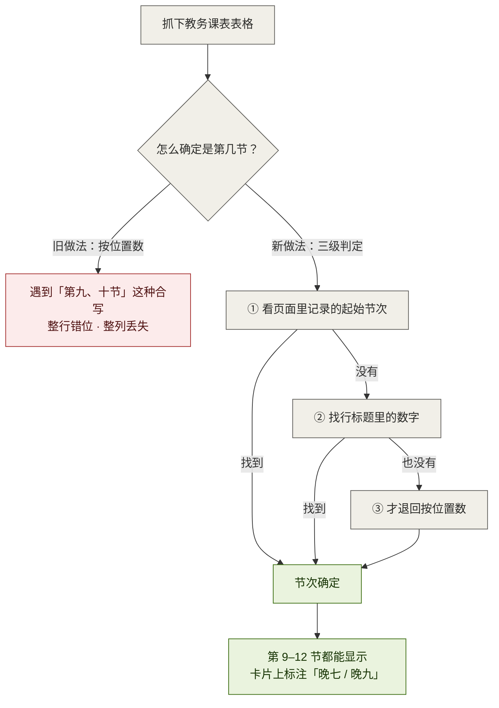
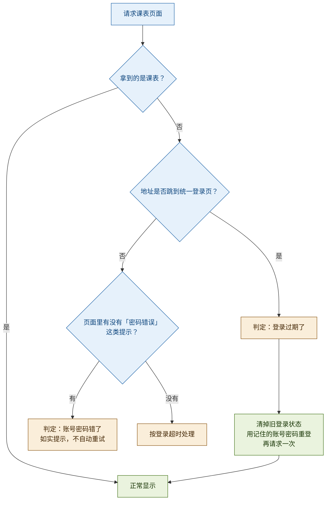

<h1>Aokiisei</h1>

武夷学院在读 · 写 Android 应用

---

## 关于

写自己每天都会打开的小工具。

课表查起来麻烦，于是有了 Mimi —— 把教务系统里散落的课表和分数，收进一个能随手打开的地方。

习惯是先让它跑起来，装到自己手机上用一阵，哪里别扭就改哪里。

---

## 项目

### [Mimi 课表](https://github.com/Aokiisei/-Mimi-)

武夷学院课程表与成绩查询工具，需要本人的教务账号登录。Android 5.0 及以上，Apache-2.0 开源。

- **课程表** —— 按周次查看，支持「全部周次」，全屏一屏看完整周
- **成绩查询** —— 分学期拉取，可展开每门课的构成
- **上课提醒** —— 课前 10 分钟提醒课程与地点，每晚汇总明日课表
- **校园公告** —— 汇总学校官网与 13 个二级学院公告
- **校园地图标注** —— 同学共同标注校园地点
- **公交查询 / 日程管理 / 桌面小组件**

安装包、更新日志和完整源码都在[仓库](https://github.com/Aokiisei/-Mimi-)里。

---

## 案例分析

记录两个做这个项目时卡住过的问题。光看现象很难想到原因，画出来会清楚一些。

### 一、晚上 19:00 的课不显示

教务页面里明明有这门课，抓下来却少了几节。排查后发现问题出在**「怎么判断一节课属于第几节」**。

教务的课表表格里，同一门课的节次有好几种写法：「第九、十节」「第9-10节」「晚上」。早先是按行标签的先后顺序去数，一遇到合写就整行错位，严重的会连整列一起丢。

改成三级判定后稳定了——**先看编号，编号没有再看标题里的数字，最后才退回按位置数**：

顺带发现另一个问题：教务首页是陆续加载出来的，有时只抓到前几门课就返回了。所以登录后会再等一会儿重新抓一次。

### 二、登录过期后一片空白

教务的登录状态会过期。过期后服务器直接把人送回登录页，页面本身不报错——用户看到的是一张空课表，不知道发生了什么。

难点在于**不能把所有异常都当成过期**：如果输错密码也走自动重登，就会反复提交，看起来像卡死。所以判定分两层：

第一层看地址有没有被送到统一登录页 —— 这说明「登录确实没了」；第二层再看页面里有没有「密码错误」这类具体提示 —— 这能区分「账号密码真的输错了」。

有个地方容易踩：判据里**特意排除了「验证码」这个词**。登录页本身就有验证码，如果把它当成错误特征，那么任何停在登录页的情况都会被判成"密码错了"，从而永远触发不了自动重登。

另外还加了一条按时间的判断：App 被系统清掉后台后重进，如果停了很久，就直接认定「登录大概过期了」，省掉一次注定失败的请求。

---

## 技术栈

---

## 联系

- 站点：[aokiisei.vxni.ink](https://aokiisei.vxni.ink)
- 邮箱：[lin_648@qq.com](mailto:lin_648@qq.com)
- 项目：[Mimi 课表](https://github.com/Aokiisei/-Mimi-)

有问题或者建议，直接发邮件就行。

---

想法很多，慢慢写。

