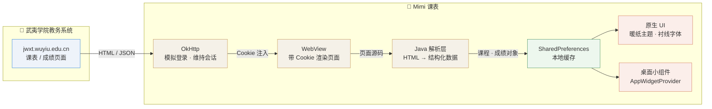
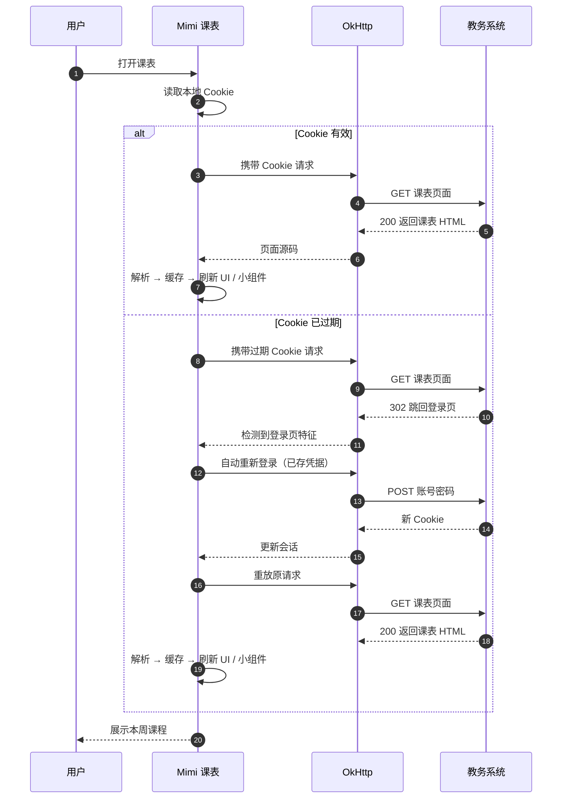

<h1>Aokiisei</h1>

做那种自己每天都会打开的小工具。

---

## 👋 关于我

武夷学院在读，写 Android 应用。

喜欢先解决自己身边的问题 —— 课表查起来麻烦，于是有了 Mimi。

信奉“能跑起来的东西才有价值”，所以每个项目都会真刀真枪地编译、装上手机、每天用。

---

## 🚀 主力项目

### 📅 [Mimi 课表](https://github.com/Aokiisei/-Mimi-)

武夷学院课程安排与成绩查询工具。把教务系统里散落的课表和分数，收进一个能随手打开的地方。

**功能**

- **课程表** —— 按周次查看当日课程，支持周次切换与全屏查看
- **成绩查询** —— 分学期拉取成绩，查看已修课程与分数
- **桌面小组件** —— 主屏直接看当天课程，不用打开应用
- **公交查询** —— 查询武夷山公交线路与到站信息
- **日程管理** —— 倒计日、单点提醒，卡片右滑标记完成
- **暖纸主题** —— 暖色调纸质视觉风格，全 App 统一衬线字体

**工程现状**：完整工程源码开源（Apache-2.0），内置 Gradle Wrapper，
`clone` 后按 README 配置即可自行编译出签名 APK —— 不是只有文档的空仓库。

#### 🏗️ 数据是怎么流动的

教务系统没有开放接口，所以整条链路是自己打通的：先模拟登录拿到会话，
再让 WebView 带着这个会话去取页面，最后把 HTML 解析成结构化数据落到本地。

#### 🔐 会话怎么保住

教务系统的会话会过期，这是这类工具最容易翻车的地方 ——
自动跳回登录页就什么都查不了了。所以做了会话超时的主动判断与无感续期：

---

## 🧰 技术栈

---

## 📬 找我

- 🌐 个人站点：[aokiisei.vxni.ink](https://aokiisei.vxni.ink)
- 💻 GitHub：[@Aokiisei](https://github.com/Aokiisei)
- 📦 项目发布：[Mimi 课表 Releases](https://github.com/Aokiisei/-Mimi-/releases)
- ✉️ QQ 邮箱：[lin_648@qq.com](mailto:lin_648@qq.com)

交流、建议、Bug 反馈都欢迎直接邮件，我看到会回。

---

想法很多，慢慢写。

